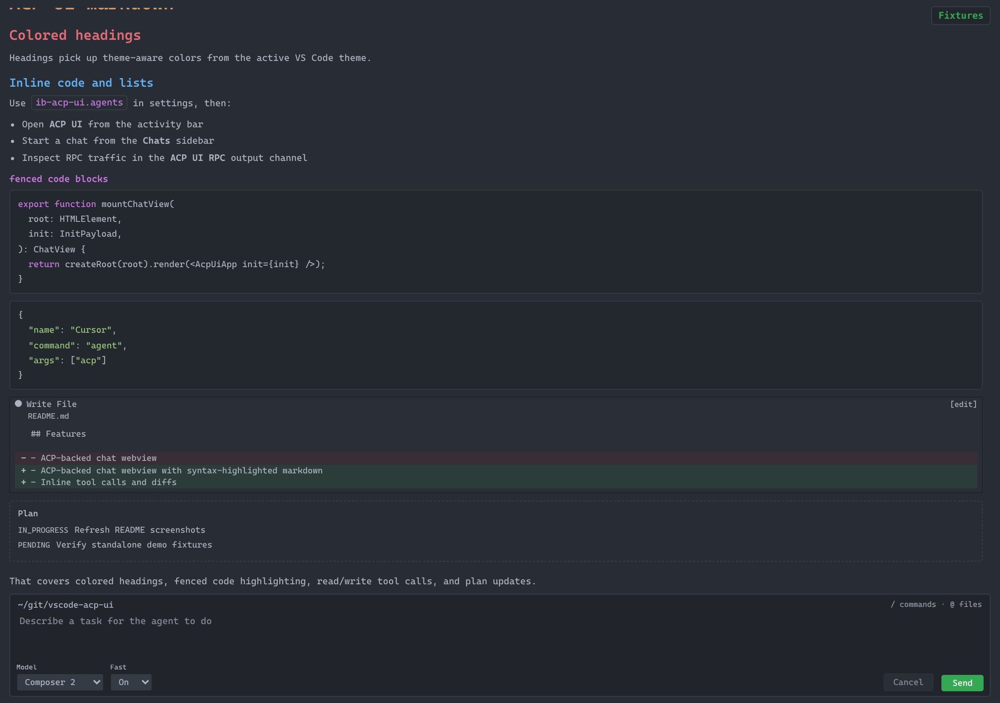
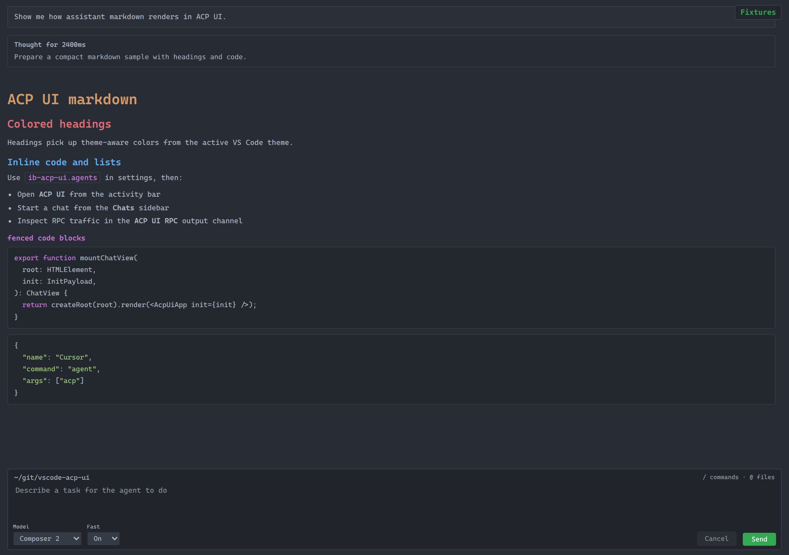
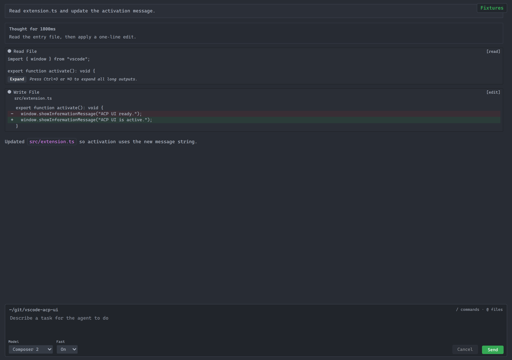
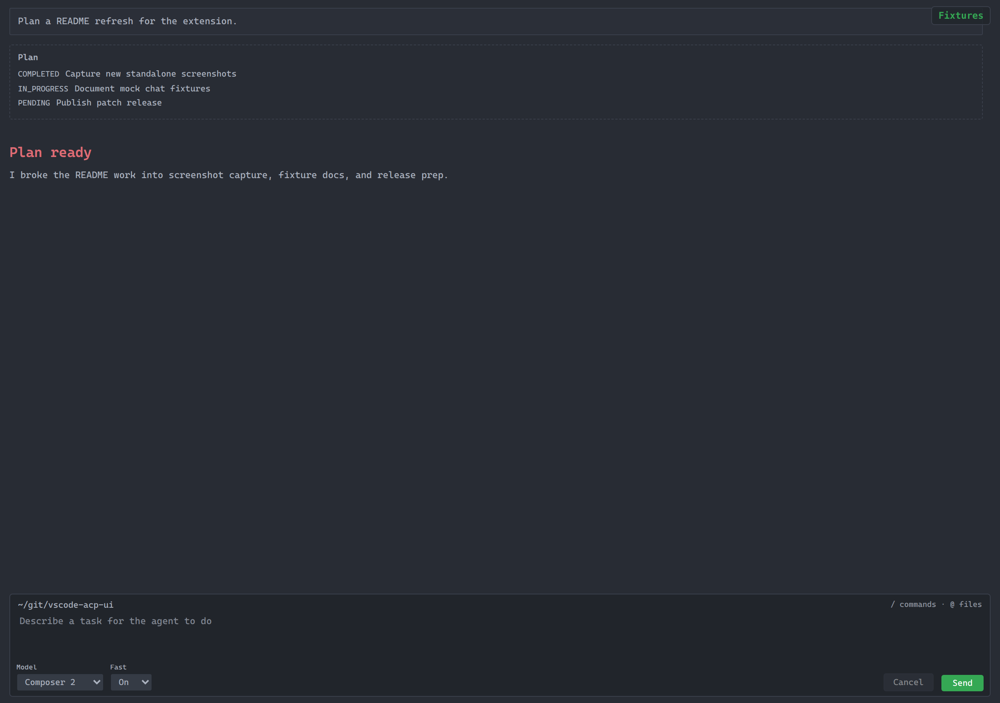
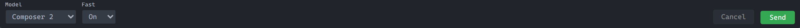
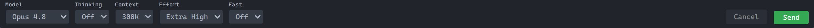

# ACP UI

VS Code extension that brings an **ACP UI** panel to the [Agent Client Protocol (ACP)](https://github.com/agentclientprotocol) — chat with configured agent processes from the editor.

Open **ACP UI** from the activity bar to get a dedicated chat surface next to your code: the **Chats** view lists sessions, and the webview shows the running conversation with the same UI in an editor tab or side panel.



_Streaming markdown, tool calls, thoughts, and plans in the ACP UI trace._

## Features

- **ACP UI** webview: ACP-backed chat in an editor tab or panel.
  Theme-aware markdown with colored headings and syntax-highlighted fenced code:

    

- **Tool calls** inline in the trace: read output, terminal runs, and file diffs:

    

- **Agent plans** rendered as structured plan blocks:

    

- **Chats** sidebar under the **ACP UI** activity bar: list sessions, open, refresh, delete.
- **Session config** in the composer when the agent advertises model and tuning options.
  Cursor-style bracketed models show a family picker plus derived params (for example **Fast**):

    

    Agents that advertise explicit `model_config` options use a Zed-style toolbar (model, thinking, context, effort, and more):

    

- **ACP UI RPC** output channel for debugging protocol traffic.
- **Agent Registry** browse/install from the official ACP catalog; optional manual override via `ib-acp-ui.agents`.

## Requirements

- VS Code `1.115.0` or newer.
- For `npx` / `uvx` registry agents: Node (npx) or [uv](https://github.com/astral-sh/uv) on your `PATH`.
- Binary registry agents download into extension storage (no global install required).
- Any auth/environment variables required by your chosen agent.

## Quick Start

1. Install the extension.
2. Open **ACP UI** from the activity bar.
3. Run **Browse Agent Registry** (Chats view title menu or command palette) and install an agent.
4. Start a chat with **Open ACP UI** or **New ACP UI in Editor**.

## Usage

### Install Agents from the Registry

Use **Browse Agent Registry** to install from the curated [ACP Registry](https://agentclientprotocol.com/get-started/registry).
Installs are stored in extension global storage (not in `settings.json`).
Refresh the catalog with **Refresh Agent Registry**, or remove an install with **Uninstall Registry Agent**.

Settings:

- `ib-acp-ui.registry.enabled` (default `true`)
- `ib-acp-ui.registry.url` (CDN catalog URL)
- `ib-acp-ui.registry.cacheTtlHours` (default `24`)

### Manual Agent Override (advanced)

Set `ib-acp-ui.agents` when you need a hand-written spawn config.
Manual entries override registry installs with the same display name.

```json
"ib-acp-ui.agents": [
  {
    "name": "My Agent",
    "command": "my-agent",
    "args": ["--acp"]
  }
]
```

Fields:

- `name`: label shown in ACP UI.
- `command`: executable to spawn.
- `args`: optional argument list.
- `env`: optional per-agent environment variables.
- `authMethodId`: optional when the agent advertises multiple auth methods.

### Common Actions

- Browse registry: `Browse Agent Registry`
- Open chat: `Open ACP UI`
- Create chat in editor: `New ACP UI in Editor`
- Focus session list: `Focus ACP UI Chats list`
- Rename/delete sessions from the **Chats** view context actions
- Inspect protocol traffic: `Show ACP RPC Log`
- Use composer slash commands from [`BUILTIN_COMMANDS.md`](BUILTIN_COMMANDS.md)

## Development

```bash
npm ci
npm run build      # webview + extension bundle (vp pack)
npm run watch:extension  # vp pack --watch
npm run watch:webview    # vp build --watch (or use the VS Code watch task)
npm run check      # vp check (lint, format, types)
npm run test       # vp test
npm run lint       # vp lint
npm run format     # vp fmt --write
npm run verify     # build + check + test
npm run install  # package .vsix and install into local VS Code (`code`)
```

For a browser-only UI loop without VS Code, use `npm run dev:playground` (see `playground/`).
Preview mock chats without a live agent:

```bash
npm run dev:playground:demo
```

Then open http://localhost:5173.
Browse mock chats and model-picker seeds from http://localhost:5173/fixtures.
The playground shell loads workbench colors and markdown syntax from your VS Code user settings (`~/.config/Code/User/settings.json` by default).
Override with `ACP_UI_VSCODE_SETTINGS=/path/to/settings.json` if needed.
In demo mode, send `fixture-markdown`, `fixture-tools`, or `fixture-plan` in the composer to replay other samples.
Set `ACP_UI_DEMO_SEED=opus-model` to preview the agent-ordered model toolbar.

Regenerate fixtures and README screenshots:

```bash
npm run screenshots
```

Publishing is automated when `package.json` **version** changes on `main` (see `.github/workflows/publish.yml`).

## Troubleshooting

- No agents in picker: run **Browse Agent Registry** and install one, or add a manual `ib-acp-ui.agents` entry.
- No responses in chat: verify the installed agent command runs and supports ACP mode (`npx`/`uvx` on PATH for package agents).
- Need diagnostics: open the `ACP UI RPC` output channel and retry the action.

## Explore

| Area                                                       | Role                                                                       |
| ---------------------------------------------------------- | -------------------------------------------------------------------------- |
| [`src/extension.ts`](src/extension.ts)                     | Extension entry: activates ACP services, ACP UI panel, Chats tree view.    |
| [`src/extension/`](src/extension/)                         | Chat webview registration, sessions sidebar, agent picker, prompt history. |
| [`src/acp/`](src/acp/)                                     | ACP session bridge, agent config from VS Code settings, RPC helpers.       |
| [`src/protocol/`](src/protocol/)                           | Messages between extension host and webview.                               |
| [`webview/acp-ui/`](webview/acp-ui/)                       | React + Vite webview UI (chat UI, markdown, state).                        |
| [`playground/`](playground/)                               | Local dev server and mocks for the webview without the extension host.     |
| [`playground/fixtures/chats/`](playground/fixtures/chats/) | Committed mock chat replays for demo and screenshots.                      |
| [`specs/`](specs/)                                         | Design notes for features and commands.                                    |
| [`media/`](media/)                                         | Activity bar and view icons.                                               |

Mock chat fixtures are built by `scripts/build-showcase-fixtures.ts` and replayed through the playground WebSocket bridge.

## License

MIT — see [`package.json`](package.json) `license` field.
